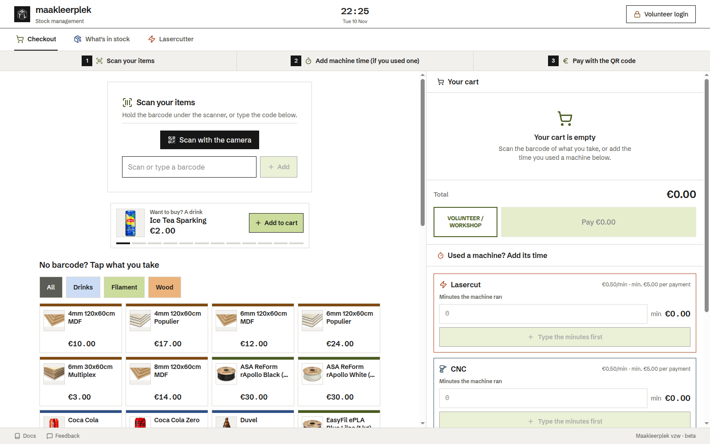
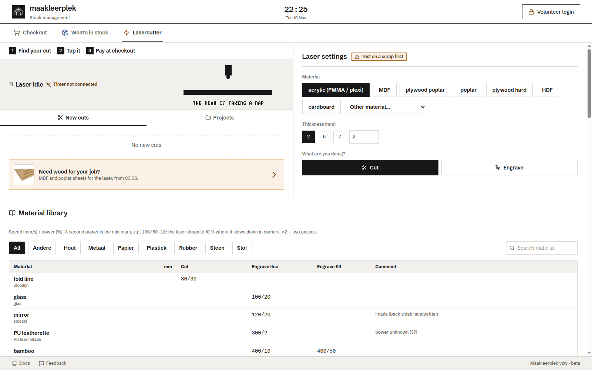

# htl-stock

The stock and checkout web app of the High Tech Lab, on top of InvenTree. Visitors scan items, add machine time and pay with a QR code. Volunteers manage stock, purchase orders and analytics.

Related: [htl-kiosk](https://github.com/maakleerplek/htl-kiosk) (the touch till) and [htl-tv](https://github.com/maakleerplek/htl-tv) (the TV screen). Guides for volunteers: [SharePoint info page](https://maakleerplek.sharepoint.com/sites/HighTechLab/SitePages/Stock-management-info-page.aspx).

| Checkout | Laser tab |
| :---: | :---: |
|  |  |

## Where it runs

| Address | Use |
|---|---|
| https://stock.int.maakleerplek.be/ | Main address, valid certificate, maakleerplek network only |
| https://10.72.1.246:8086/ | htl-server directly (self-signed), used by the kiosk |

`htl-tempserver` (10.72.3.68) is a test server with old data.

## What it does

- **Checkout:** scan with a USB scanner or the camera, add laser/CNC minutes or 3D-print grams, pay with an EPC (Wero) or Payconiq QR. Every sale is an InvenTree sales order on "Walk-in customer".
- **Laser:** an ESP32 on the laser sends ON/OFF over UDP to `core/`. After 5 s off the time becomes a cut; visitors tick their cuts and pay. The tab also gives speed and power per material, from InvenTree parts in the category *Lasermaterialen*.
- **Volunteers** (Authentik sign-in): stock changes, new parts, purchase orders, data repair, analytics.

## Develop

```bash
npm install
npm run dev      # Vite, proxies InvenTree with the token from .env
npm test
npm run lint
```

`LASER_SIMULATE=1` adds a button that switches the laser on and off, so the laser tab works without the ESP32.

## Deploy

`master` is production. On htl-server cron runs `scripts/autodeploy.sh` every 5 minutes: once CI on a new commit is green it runs `docker compose up -d --build`, and rolls back if a container is not healthy. Log: `.git/autodeploy.log`.

`.env` (copy `.env.example`) holds `INVENTREE_TOKEN`, `OIDC_CLIENT_SECRET` and `OAUTH2_COOKIE_SECRET`. Only the proxy uses them; the browser never sees them. Which calls need a volunteer is in `src/lib/apiAccess.ts` and `nginx.conf.template`.

## Layout

```
src/                  React 19 + TypeScript, Vite, Tailwind v4
core/                 Laser service + till endpoint (Flask, Socket.IO, SQLite)
esp/monitorOTA/       ESP32 firmware; scripts/esp-ota.sh flashes it over Wi-Fi
laser-timer-widget/   Timer bar + LightBurn watcher for the laser PC
nginx/                Proxy: InvenTree token, volunteer-only rules
tests/                Vitest, incl. pricing cases shared with htl-kiosk
```

Design: [STYLING_GUIDE.md](./STYLING_GUIDE.md). Open work: [TODO.md](./TODO.md).

## License

MIT
